  

# Awesome-Enterprise-Priority-Support-Service-Tier ⚡

  
  
  
  
  

> 🚀 A curated list of enterprise priority support tiers, SLA-backed service contracts, mission-critical customer support platforms, and self-hosted open-source helpdesk solutions.

Enterprise priority support tiers govern mission-critical response times, assigned Technical Account Managers (TAMs), and guaranteed SLAs. This repository tracks major commercial SaaS priority support plans alongside active open-source helpdesk tools that empower organizations to internalize L1/L2 triage and optimize support spend. 🛡️💼

---

## 📑 Table of Contents
- [📊 Sector Overview & Market Dynamics](#-sector-overview--market-dynamics)
- [☁️ SaaS Platforms & Enterprise Support Tiers](#️-saas-platforms--enterprise-support-tiers)
- [💻 Open-Source GitHub Projects](#-open-source-github-projects)
- [💡 Support Tier Cost Optimization Strategy](#-support-tier-cost-optimization-strategy)
- [🤝 How to Contribute](#-how-to-contribute)
- [💖 Support & Sponsorship](#-support--sponsorship)
- [⭐ Star History](#-star-history)
- [⚖️ Disclaimer & License](#️-disclaimer--license)

---

## 📊 Sector Overview & Market Dynamics

The global customer service and enterprise support software market is estimated at **$11.0 billion in 2025** and projected to reach **$26.3 billion by 2034** (growing at a ~10.2% CAGR), while the broader IT managed support and business support services sector exceeds **$400 billion**. The enterprise support market is **moderately concentrated at the hyperscaler and infrastructure tier** (dominated by AWS, Google Cloud, and ServiceNow, where high switching costs create quasi-winner-take-all dynamics for critical workloads), but remains **highly fragmented across mid-market ticketing, omnichannel customer engagement, and helpdesk tools**, where dozens of SaaS vendors and self-hosted open-source alternatives compete aggressively on per-seat pricing and customization. 🌐📈

---

## ☁️ SaaS Platforms & Enterprise Support Tiers

The table below lists leading enterprise priority support and customer support platforms, sorted in descending order by parent company market capitalization / valuation. 🏢🏷️

| Product | Company Valuation / Revenue | Pricing (Starting Tier) | Free Tier / Trial Limits | Description |
|:---|:---|:---|:---|:---|
| **[Google Cloud Premium Support](https://cloud.google.com/support/premium)** | **~$3.60T** market cap (Alphabet) / $350B+ rev | **$15,000/month** base fee + 3%–10% of monthly cloud spend (Standard Support starts at $29/mo + 3%) | **$300 credit for 90 days**; Always Free tier includes 1 `e2-micro` VM, 5 GB Cloud Storage, 1 TB BigQuery queries/mo | Enterprise-grade cloud support offering **15-minute response times for P1 issues**, customer-aware context, and a named Technical Account Manager (TAM). |
| **[AWS Enterprise Support](https://aws.amazon.com/premiumsupport/pricing/)** | **~$2.88T** market cap (Amazon) / $160B+ AWS run rate | **$50,000/month** minimum or tiered percentage of AWS spend (10% down to 3%; Developer starts at $29/mo) | **12-Month Free Tier** (750 hrs/mo `t2.micro`/`t3.micro`, 5 GB S3) + **Always Free** (1M Lambda requests, 25 GB DynamoDB) | The gold standard for infrastructure support. Features a dedicated Technical Account Manager (TAM), **15-minute response for business-critical events**, and Incident Detection and Response. |
| **[ServiceNow Impact](https://www.servicenow.com/)** | **~$107B** market cap (NYSE: NOW) / $15.4B rev | **$70 per user/month** (ITSM Foundation base; Impact Guided packages start from custom annual quotes ~$12,000–$50,000+) | **Free Personal Developer Instance (PDI)**; full platform access, hibernates after 10 hrs inactivity, reclaimed after 10 days without login | AI-powered value acceleration, proactive instance health monitoring, guided architecture reviews, and designated support account management. |
| **[Zoho Prime / Zoho Desk](https://www.zoho.com/desk/)** | **~$12.5B** valuation (private bootstrapped) / $1.5B rev | **$14 per agent/month** billed annually (Zoho Desk Standard; Zoho Prime partner support starts at 299 DKK/user/mo) | **Free forever plan** for up to **3 agents** (includes email ticketing, private knowledge base, macro workflows; 15-day free trial on paid plans) | Comprehensive support and customer engagement platform offering SLA rules, omnichannel ticketing, and partner-backed priority SLAs with 6-hour critical response. |
| **[Zendesk Premier Support](https://www.zendesk.com/)** | **~$10.2B** acquisition valuation (Hellman & Friedman) / ~$2.0B ARR | **$19 per agent/month** billed annually (Support Team; Premier Support add-on is **20% of annual contract value**) | **14-day free trial** with full access to Zendesk Suite Professional features (no credit card required; eligible for 14-day extension upon request) | Enterprise omnichannel ticketing with 24/7/365 priority queuing, designated technical relationship managers, and guaranteed SLA response times. |
| **[Freshdesk Omnichannel / Platinum](https://www.freshworks.com/freshdesk/)** | **~$3.2B** market cap (NASDAQ: FRSH) / $930M rev | **$19 per agent/month** billed annually (Growth tier; Omnichannel Growth from $29/agent/mo; Enterprise at $89–$119/agent/mo) | **14-day free trial** with complete access to Enterprise features; free plan available for up to 2 agents on standard ticketing | Omnichannel customer service platform featuring AI-assisted ticket routing, automated SLA escalations, and 14-week guided onboarding deployments. |

---

## 💻 Open-Source GitHub Projects

Self-hosted open-source helpdesk and service desk systems provide full control over queue management, custom escalation rules, and SLA tracking without recurring per-agent licensing fees. 🛠️🔓

The table below is sorted in descending order by GitHub stargazer count.

| Project | Stars_Badge | Tech Stack | Key Capabilities & SLA Features |
|:---|:---|:---|:---|
| **[Chatwoot](https://github.com/chatwoot/chatwoot)** |  | Ruby / Vue.js | Modern omnichannel customer engagement suite. Unifies website live-chat, email, WhatsApp, Twitter/X, and Telegram into a unified inbox with custom webhook integrations. |
| **[UVdesk](https://github.com/uvdesk/community-skeleton)** |  | PHP (Symfony) | Modular, enterprise-ready helpdesk ticketing system. Supports multi-channel ticket conversion, extensible workflow events, automated ticket forwarding, and agent privilege control. |
| **[Apache Answer](https://github.com/apache/incubator-answer)** |  | Go / React | Knowledge-base and community Q&A platform. Significantly deflects repetitive tier-one support tickets by empowering users and internal teams with searchable documentation. |
| **[GLPI](https://github.com/glpi-project/glpi)** |  | PHP / MySQL | Comprehensive IT Asset Management (ITAM) and ITIL service desk. Directly ties tickets, changes, and SLA breach tracking to hardware inventory, software licenses, and network devices. |
| **[Zammad](https://github.com/zammad/zammad)** |  | Ruby on Rails | Full-featured helpdesk with out-of-the-box SLA management, multi-channel intake (email, telephone, chat, social media), and audit trails without feature paywalls. |
| **[FreeScout](https://github.com/freescout-help-desk/freescout)** |  | PHP (Laravel) | Lightweight shared inbox and ticketing system built as a self-hosted alternative to Help Scout and Zendesk. Runs smoothly on 1–2 GB RAM with zero user or ticket limitations. |
| **[osTicket](https://github.com/osTicket/osTicket)** |  | PHP / MySQL | Proven open-source support ticket system. Features configurable SLA policies, ticket auto-assignment, customer portal, and role-based permissions without commercial upcharges. |
| **[Frappe Helpdesk](https://github.com/frappe/helpdesk)** |  | Python / MariaDB | Clean, modern customer service platform with built-in SLA management, agent assignment rules, customer portal, and tight integration with the Frappe/ERPNext ecosystem. |
| **[Helpy](https://github.com/helpyio/helpy)** |  | Ruby on Rails | Modern multi-channel helpdesk application with integrated customer knowledge base, community support forums, and email ticketing integration. |
| **[Request Tracker (RT)](https://github.com/bestpractical/rt)** |  | Perl | Industrial-grade issue tracking and ticketing platform trusted by enterprises, universities, and government agencies for high-volume technical ticket triage and automation. |
| **[Znuny](https://github.com/znuny/znuny)** |  | Perl | Enterprise-grade fork and continuation of OTRS. Provides strict ITIL-compliant process management, granular role-based escalation paths, and comprehensive SLA tracking. |

---

## 💡 Support Tier Cost Optimization Strategy

1. 🎯 **Internalize L1/L2 Triage:** Deploy self-hosted systems (such as Zammad or FreeScout) to handle internal routing and resolve application-level incidents before escalating to cloud vendor priority support.
2. 🔍 **Audit Spend Percentage Uplifts:** Commercial priority tiers (such as AWS Enterprise Support at 3%–10% or Zendesk Premier at 20%) scale linearly with contract value. Validate whether specialized third-party support partners can deliver equivalent TAM coverage at a fixed cost.
3. ⏱️ **Establish Rigorous Severity Classifications:** Response SLAs only trigger on accurately tagged tickets (e.g., P1 vs. P2). Train operations teams on the exact criteria required by vendor contracts to avoid paying for unused fast-response guarantees.

---

## 🤝 How to Contribute

Contributions are welcome! Please follow these guidelines: 🌟
1. Fork the repository.
2. Add or update entries following the table format.
3. For SaaS products: include verified starting tier pricing, explicit free tier or trial duration limits, and parent company valuation/revenue metrics.
4. For open-source projects: ensure the repository is active, add the stargazer social badge linking to `/stargazers`, and note key SLA capabilities.
5. Submit a pull request with a concise explanation of changes.

---

## 💖 Support & Sponsorship

Thank you so much for exploring and supporting this repository! 🙌

If you find this curated ecosystem helpful for your IT architecture, procurement planning, or DevOps support operations:
- ⭐ **Star this repository** to help others discover it on GitHub.
- 🍴 **Fork and share** it with your engineering and IT operations teams.
- ☕ **Buy me a coffee / Sponsor**: If you'd like to support ongoing research and updates, consider sponsoring via the [GitHub Sponsor Dashboard](https://github.com/sponsors/ishandutta2007). Your support is greatly appreciated!

---

##  Star History

---

## ⚖️ Disclaimer & License

- ℹ️ This list is curated for informational, educational, and procurement evaluation purposes. Product names and trademarks are property of their respective owners.
- 📄 Distributed under the [Creative Commons Zero v1.0 Universal License](http://creativecommons.org/publicdomain/zero/1.0/).
